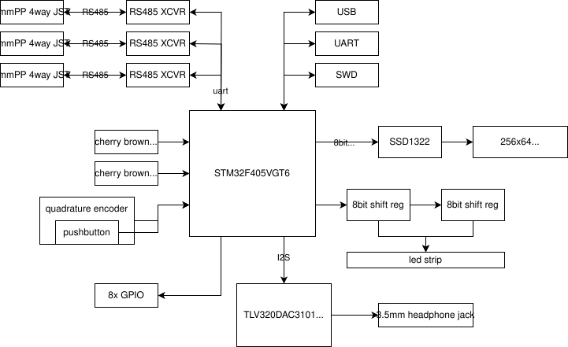
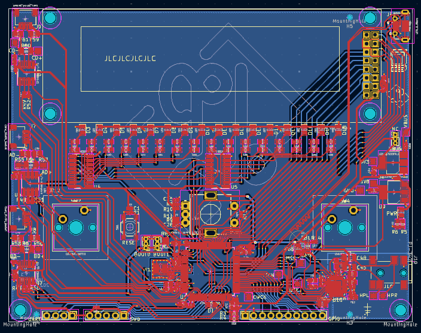
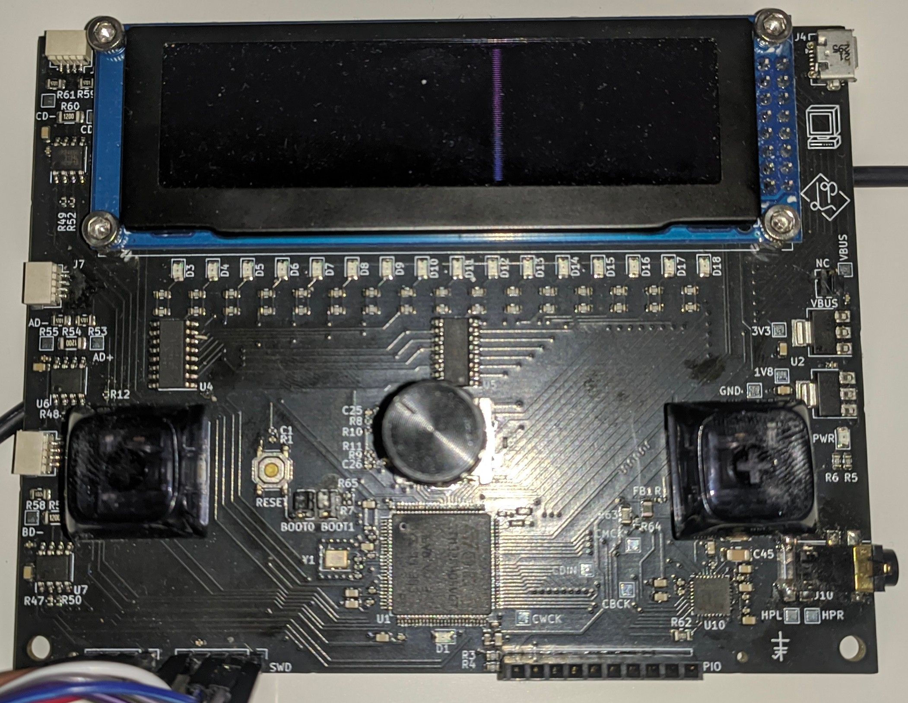
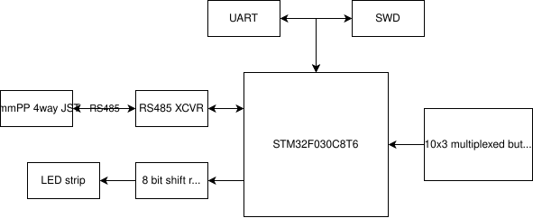
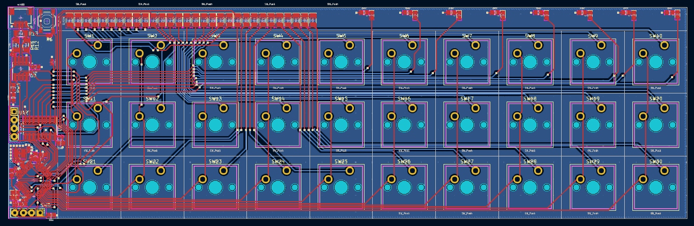
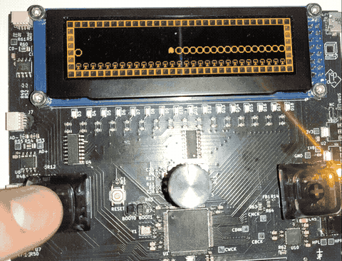
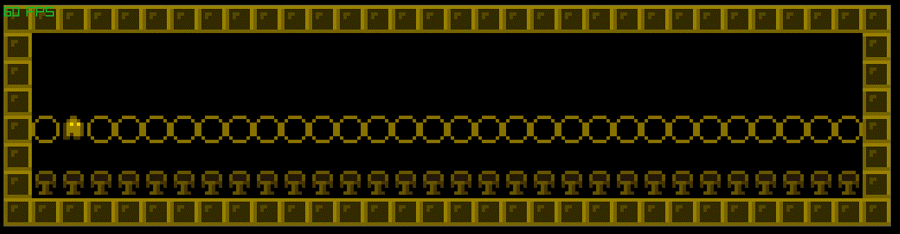

# sbc3: small computing environment
Self contained board that can be easily programmed on target for fun little
games or GUIs. Inspired by the environment presented by TI calculators and
TI-BASIC.

## Components
### main_board_v1
#### System diagram

#### PCB

#### Manufactured

- PCB and assembly done by JLCPCB
- Extended parts used:
  - TLV320DAC3101IRHBR Audio DAC
  - 475900001 Micro-USB connector
  - LD1117S33TR 3V3 Linear Regulator
    - Honestly can't remember why I went for this one instead of the JLC
    preferred part AMS1117-3.3.
    point and needed low quiescent?
  - LD1117S18TR 1V8 Linear Regulator (for DAC)
  - STM32F405VGT6 MCU

#### Changes and ideas for v2
- [ ] Ability to disconnect 3v3 from rs485 connectors
- [ ] Isolation transformers on rs485 for long connections
- [ ] External flash or eeprom or FRAM for filesystem
- [ ] "Cartridges" with flash
- [ ] Label all the headers pin for pin to avoid looking on the schematic every
time you're connecting the SWD
- [ ] Fix BOOT0/BOOT1? Or just 0ohm unpopulated for de-bricking?
- [ ] Proper enclosure
- [ ] ESD diode protection on all inputs
- [ ] External qspi flash (w25q128jv)
- [ ] Wire OE on LED shift registers to a PWMable pin! So you can easily pwm the brightness
- [ ] 18650 batteries + holder?
- [ ] smaller form factor with parts hidden underscreen and less rs485 or more
compact layout (look for resistor/cap sizing for 0402 wattage)
- [ ] ACTUALLY WIRE UP THE BUTTONS AND ENCODER THIS TIME!
    - Of all the things to screw up on the first PCB run, I didn't expect to
    completely forget to connect the button and rotary nets
- [ ] Tiny JST connectors really are shit! Hot pluggable trs circuit?
Enable/disabable power chip? Need to get this right before making a bunch of peripheral boards.

### keyboard_v1
#### System diagram

#### PCB

Not yet manufactured, since still thinking about re-doing the comms (definitely
not going to use the current JST connectors as theyre much too finicky).

### virtual machine
Also included is a stack based virtual bytecode machine (see [software/vm](./software/vm)).
The bytecode can call out to pre-defined system modules, including graphics
routines. Below is an example of the main board STM32 and a Linux desktop
running the same bytecode program.

#### STM32

#### Linux desktop

As the bytecode is stack based, a thin forth layer has been built for it, which
is currently assembled by a python script. See the source program for the above gifs [here](./software/vm/programs/tilemap.sbcs).